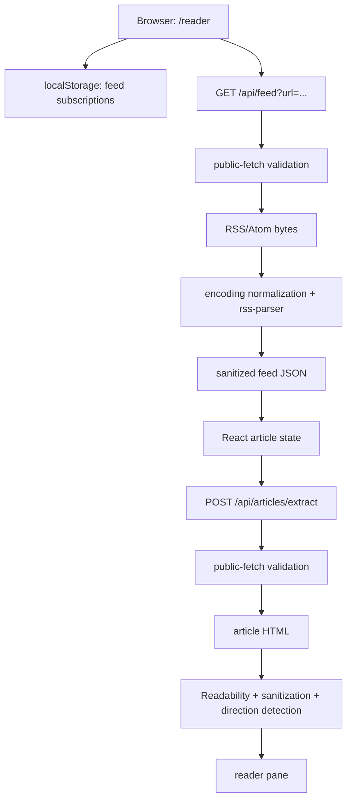

# Architecture

## Summary

Al-Rawi is a single Next.js App Router application. The landing and reader
surfaces are client components. The reader stores only feed subscription
metadata locally, then calls two Node.js route handlers to fetch public feed XML
or public article HTML. Parsing, encoding normalization, extraction, and
sanitization happen in server-side libraries; article state remains in the
reader page’s React state.

## Module map

| Module | Responsibility |
|---|---|
| `src/app/page.tsx` | Re-exports the landing page as the root route. |
| `src/app/landing/page.tsx` | Bilingual landing experience. |
| `src/app/reader/page.tsx` | Reader orchestration and in-memory state. |
| `src/components/` | Reader panes, dialogs, providers, and UI primitives. |
| `src/hooks/use-keyboard-nav.ts` | Global J, K, O, M, `/`, and R reader shortcuts outside editable controls. |
| `src/lib/local-reader.ts` | Feed subscription serialization and validation. |
| `src/lib/public-fetch.ts` | Public URL validation, DNS checks, redirect and byte limits, timeout. |
| `src/lib/feed-parser.ts` | RSS/Atom parsing, article mapping, sanitization. |
| `src/lib/encoding-normalizer.ts` | UTF-8 and legacy Arabic encoding handling plus direction/language detection. |
| `src/lib/content-extractor.ts` | Mozilla Readability extraction and sanitized article output. |
| `src/lib/opml-parser.ts` | Server-side OPML parse/generate utility; Settings also contains a browser-side parser. |

## Main data flow

## External boundaries and controls

Google web authentication uses app-hosted Better Auth in `src/lib/auth/app.ts` and
`src/app/api/auth/[...path]/route.ts`. It reuses the existing Neon Auth schema and
user UUIDs. The backup route validates the signed session through
`src/lib/auth/server.ts` before using that user ID in every backup query. The
Google callback is hosted on `al-rawi-rss.vercel.app`; the public reader and native
Gmail/YouTube source permissions retain their existing boundaries.

- The app makes outbound requests only through the two same-origin route
  handlers for reader operations.
- `fetchPublicResource` accepts only HTTP(S), rejects private hostnames and
  private/reserved IP ranges, validates redirect destinations, allows at most
  three redirects, applies a 15-second timeout, and enforces a byte limit per
  request.
- Feed responses are limited to 4 MB. Article HTML responses are limited to
  8 MB and must have an HTML content type.
- Feed and extracted article HTML are sanitized before the client renders it.

## Risks and coupling

- Reader freshness depends on the availability and shape of third-party RSS and
  article sources.
- Local-only state means clearing browser storage removes subscriptions; the
  current session’s articles are not recoverable after reload.
- Public-fetch and sanitization changes affect both external-request safety and
  content rendering; review them together.
- Focused library tests cover encoding and PWA helpers; `Unknown / verify` for
  broader mounted UI and browser regression coverage.

## Progressive web app boundary

The browser client registers `public/sw.js` only in production. The worker
uses a bounded network-first document cache for `/` and `/reader`, a bounded
cache-first strategy for same-origin Next static assets and images, and never
caches `/api/*`, auth, or cross-origin responses. It does not make the current
in-memory article session available offline; offline support is limited to the
cached application shell and previously visited documents/assets.

`src/components/pwa-provider.tsx` owns install-event lifecycle, standalone and
WebView classification, dismissal/recovery timestamps, and browser handoff.
The reader toolbar provides a persistent install action after the transient
promotion is dismissed. iOS uses manual Safari instructions, while likely
Android WebViews receive an intent URL with an HTTPS fallback and a selectable
copy link. The host application may still block external-browser navigation.

## Privacy-first Content Hub extension

The existing Next.js RSS Reader and SSRF-protected article extraction backend
remain. The new unified Inbox saves entries and triage states to client-side
IndexedDB. Read state (readAt) and organization (new, saved, done, archived)
are independent; source refreshes preserve both. IndexedDB v2 removes old
notification-derived items if any were previously copied there.

The Android Native NotificationListenerService is REMOVED. MainActivity
deletes the historical notifications.db on app upgrade. The new
SharedContentPlugin receives only user-initiated ACTION_SEND text/URL shares
from the Android Sharesheet. A small local queue is only acknowledged after
successful IndexedDB persistence, surviving WebView startup delays.

Actual sources: public RSS/Atom feeds (including GitHub public releases),
pasted links and notes, Android explicit Sharesheet, and optional Android
Google OAuth connections to Gmail and YouTube. Google tokens use Android
Keystore AES-GCM. The Gmail readonly scope is restricted and allows access to
more than just the selected label, though the importer only fetches that
label's recent messages. Gmail text bodies are fetched on-demand. YouTube
video playback uses click-to-load privacy-enhanced embeds.

No generic listener can safely and permissionlessly capture WhatsApp or
other apps' notifications. No cross-device sync or guaranteed background
content polling is implemented. Only sources with actual authorized APIs
should be marked connected.

The Android Capacitor export temporarily moves Node API routes then
restores them. Native RSS requests use the existing production backend;
the browser uses same-origin Next.js API routes.

See docs/revival-verification.md for OAuth, privacy and physical-device checks.
